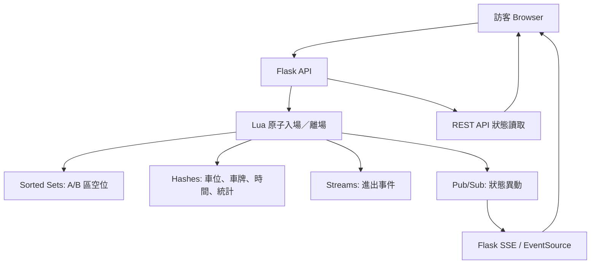

# ParkWise — Redis 智慧停車場管理系統

> 個人小專題：Python Flask + Redis + Docker + 原生 HTML/CSS/JavaScript 及 SSE。
>
> **本專題為教學模擬**，不連接車牌辨識、柵欄機、支付設備，也沒有正式帳號登入機制。

## 功能

- **20 格即時車位地圖**：A 區 12 格、B 區 8 格，綠色空位 / 紅色已停車
- **入場自動分配**：使用 Redis Sorted Set (`ZPOPMIN`) 選最小編號的空車位；可指定區域
- **防止超額入場**：Redis Lua Script 將選位、檢查重複車牌、寫入資料合併成原子操作
- **車輛離場計費**：每小時 NT$30，至少計 1 小時，出場即歸還車位
- **進出紀錄**：Redis Streams 保存入場與離場事件；Dashboard 顯示最近 12 筆
- **即時通知**：Redis Pub/Sub + Flask SSE (EventSource) 通知瀏覽器刷新；另有定時刷新保底
- **管理員重設**：Redis Pipeline + Transaction 恢復 20 格並清空舊測試資料
- **多人壓力測試**：50 個模擬車牌競爭 20 格，並模擬車位「離場→再入場」循環

## Windows 執行步驟

系統需求：Python 3.10+、Docker Desktop（先開啟）。

1. 將 ZIP 解壓縮到桌面，進入 `ParkWise` 資料夾，在 PowerShell 執行：

   ```powershell
   cd "$HOME\Desktop\ParkWise"
   docker compose up -d
   docker compose exec redis redis-cli ping
   ```

   成功會看到 `PONG`。

2. 安裝 Python 依賴：

   ```powershell
   py -m venv .venv
   .\.venv\Scripts\python.exe -m pip install -r requirements.txt
   ```

3. 建立自己的設定檔：

   ```powershell
   copy .env.example .env
   notepad .env
   ```

   **修改 `ADMIN_TOKEN` 為自己的密碼**，不能直接沿用範例值。`REDIS_URL` 預設連至本機 Docker 提供的 `6380` 埠。

4. 啟動 Flask（保留視窗不要關閉）：

   ```powershell
   .\.venv\Scripts\python.exe app.py
   ```

5. 打開網站：**http://127.0.0.1:5001**，管理後台：**http://127.0.0.1:5001/admin**。

### 執行完整測試

保留 Flask 執行中的 PowerShell，再開**另一個** PowerShell：

```powershell
cd "$HOME\Desktop\ParkWise"
.\.venv\Scripts\python.exe load_test.py --users 50 --workers 50 --turnover 5 --reset
```

`--reset` 會先使用 `.env` 的 `ADMIN_TOKEN` 重設資料；請勿在其他人在使用系統時執行。

**乾淨環境的預期結果**：

- 第一階段：`ENTERED: 20`、`FULL: 30`、目前已停 20 格、剩餘 0 格
- 第二階段：5 台離場，空出 5 格，另外 5 台新車入場
- 最終：已停 20 / 20，累計入場 25、離場 5、模擬營收 NT$150（若每次離場都未滿一小時）
- Redis Streams 有 30 筆進出事件（20 次初始入場 + 5 次離場 + 5 次新車入場）

此測試使用 ThreadPoolExecutor 模擬最多 50 個並行工作執行緒，不等於 50 台車在完全相同奈秒進場。結果以實際輸出為準。

### Redis CLI 驗證

```powershell
docker compose exec redis redis-cli ZCARD parkwise:free:A
docker compose exec redis redis-cli ZCARD parkwise:free:B
docker compose exec redis redis-cli HLEN parkwise:occupied
docker compose exec redis redis-cli HLEN parkwise:plate_spot
docker compose exec redis redis-cli HGETALL parkwise:metrics
docker compose exec redis redis-cli XLEN parkwise:events
docker compose exec redis redis-cli XREVRANGE parkwise:events + - COUNT 5
```

也可以直接執行以下程式檢查資料結構一致性：

```powershell
.\.venv\Scripts\python.exe verify_redis.py
```

此驗證會檢查 `A 區空位 + B 區空位 + 在場車輛 = 20`，以及車牌／入場時間資料的數量是否一致。

### ParkWise 本機連接埠

| 服務 | 使用方式 | 連接埠 |
|---|---|---:|
| Flask 網站 | 瀏覽器開啟 `http://127.0.0.1:5001` | 5001 |
| Redis 資料庫 | Docker Compose 將本機 `6380` 映射到容器內 `6379` | 6380 |

在專案根目錄執行 `docker compose up -d` 啟動 Redis 容器。Flask 程式透過 `.env` 的 `REDIS_URL` 連線。雲端部署時，將 `REDIS_URL` 改為雲端 Redis 的連線字串，無須使用本機 Docker。

## 系統流程



## Redis 進階功能

| 功能 | Key / 程式位置 | 應用 |
|---|---|---|
| **Sorted Set** | `parkwise:free:A`, `parkwise:free:B` | `ZPOPMIN` 分配編號最小的空位；`ZADD` 出場歸還 |
| **Lua Script** | `app.py` 的 `ENTER_LUA`, `EXIT_LUA` | 原子性防止車位超額分配／防重複車牌／歸還車位 |
| **Streams** | `parkwise:events` | `XADD` 進出紀錄、`XREVRANGE` 查詢事件 |
| **Pub/Sub** | `parkwise:updates` | `PUBLISH` 更新通知，SSE 訂閱即時刷新 |
| **Pipeline + Transaction** | `reset_demo()` | `MULTI/EXEC` 重建模擬資料 |
| Hash | `parkwise:occupied` 等 | 車位與車牌對照、計費時間、統計 |

## 主要檔案

```
ParkWise/
├─ app.py
├─ load_test.py
├─ verify_redis.py
├─ docker-compose.yml
├─ requirements.txt
├─ .env.example
├─ .gitignore
├─ README.md
├─ DEPLOY_GUIDE_TW.md
├─ PROJECT_SUMMARY.md
├─ wsgi.py
├─ render.yaml
├─ templates/
│  ├─ index.html
│  └─ admin.html
└─ static/
   ├─ style.css
   ├─ app.js
   └─ admin.js
```

## 注意事項與後續擴充

- 本機教學測試用，未實作使用者身份驗證、正式車牌辨識、持續營運的歷史資料庫、付款或時區校正。
- 為避免記錄敏感資料，建議只使用模擬車牌，不要輸入真實車牌。
- 首次啟動時若無初始資料會自動建立 20 個空車位；之後資料由 Redis AOF 持久化，重設請從後台操作。
- Redis Pub/Sub 是即時訊號，不會保留離線訂閱者訊息；永久事件以 Streams 記錄。
- 部署到公開網路前，須加入完整權限控制、TLS、流量限制、監控與安全評估；此版本僅供短期教學展示，公開環境請只使用假車牌，並評估身分驗證、速率限制及服務商安全設定，不適合正式商業營運。

## 官方文件

- [Redis scripting](https://redis.io/docs/latest/develop/programmability/eval-intro/)
- [Redis ZPOPMIN](https://redis.io/docs/latest/commands/zpopmin/)
- [Redis Streams](https://redis.io/docs/latest/develop/data-types/streams/)
- [Redis Pub/Sub](https://redis.io/docs/latest/develop/interact/pubsub/)


## 雲端部署（Render）

詳見 [`DEPLOY_GUIDE_TW.md`](DEPLOY_GUIDE_TW.md)。請使用 `wsgi.py` 與雲端 Redis URL；勿將 `.env` 上傳 GitHub。
